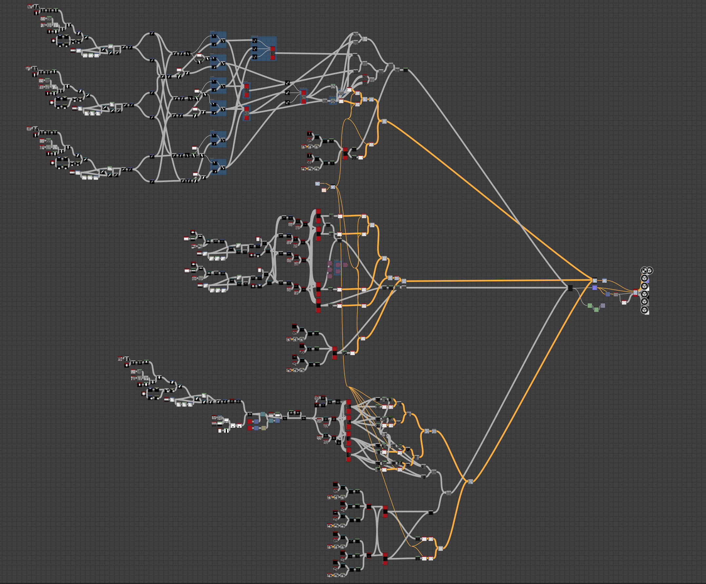
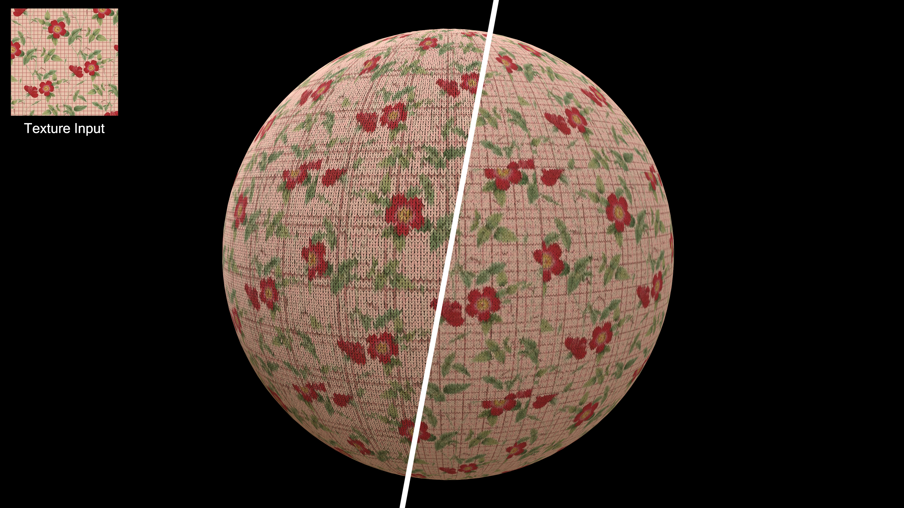
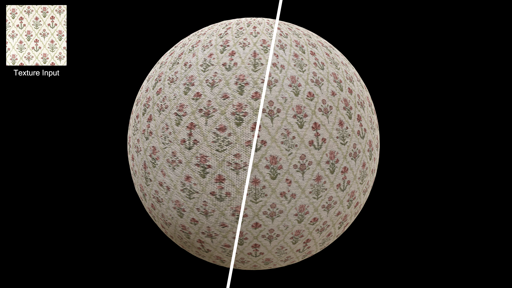
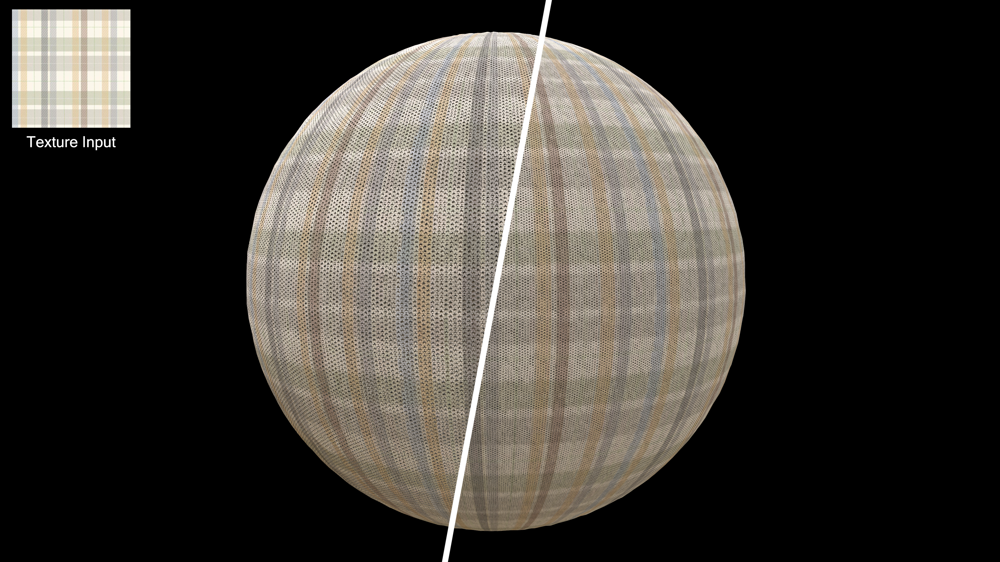
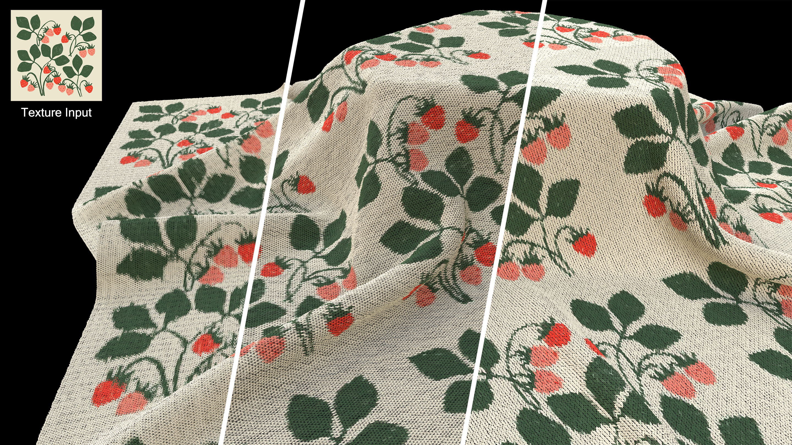
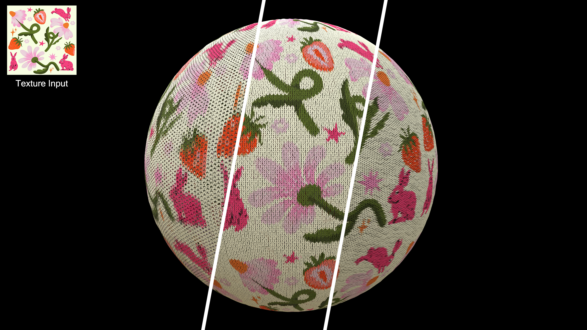
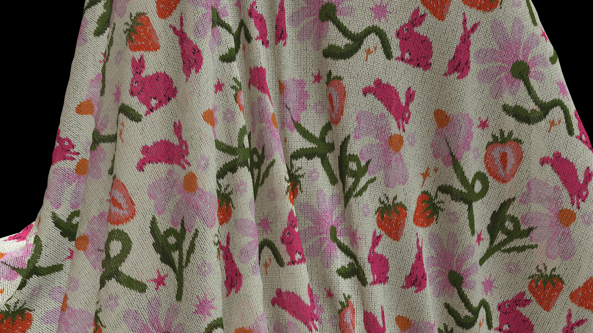
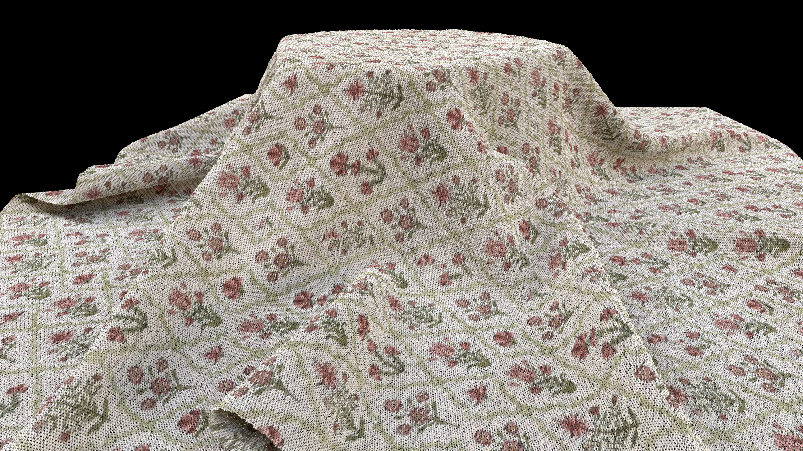
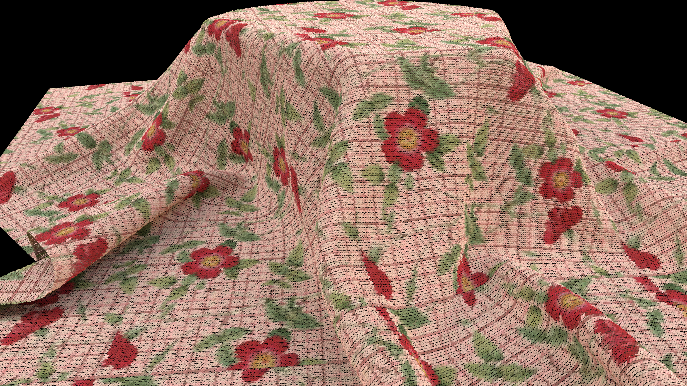
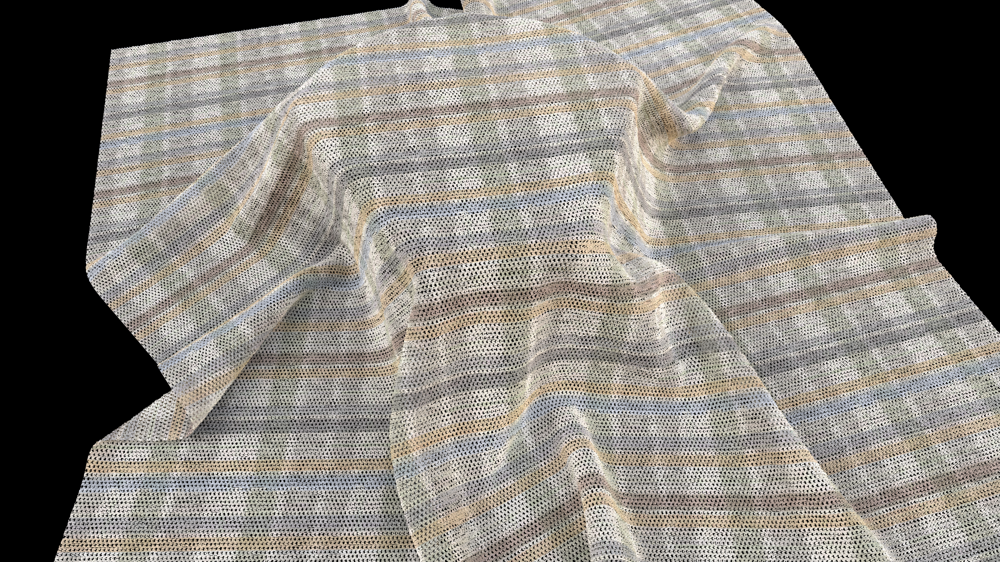

<video width="100%" height="auto" controls muted autoplay loop>
  <source src="/assets/img/20211026/Select a file name for output files_004.mp4" type="video/mp4">

</video>

## 目标功能

此程序化材质的目标效果为基于输入的纹理素材一键式生成三种不同的针织纹理，并暴露部分参数让美术有一定的调整自由度。

## 制作流程

{: width="972" height="589" }
_The entire workflow_

## 程序化生成三种针织纹理

### Type1.
{: width="972" height="589" }
_Type1 in different amount parameter_

### Type2.
{: width="972" height="589" }
_Type2 in different amount parameter_

### Type3.密集针脚刺绣
{: width="972" height="589" }
_Type3 in different amount parameter_

## 材质使用演示 

<video width="100%" height="auto" controls muted autoplay loop>
  <source src="/assets/img/20211026/SD_KnitGenerator.mp4" type="video/mp4">

</video>

## 效果展示

{: width="972" height="589" }

{: width="972" height="589" }

{: width="972" height="589" }

{: width="972" height="589" }

{: width="972" height="589" }

{: width="972" height="589" }

