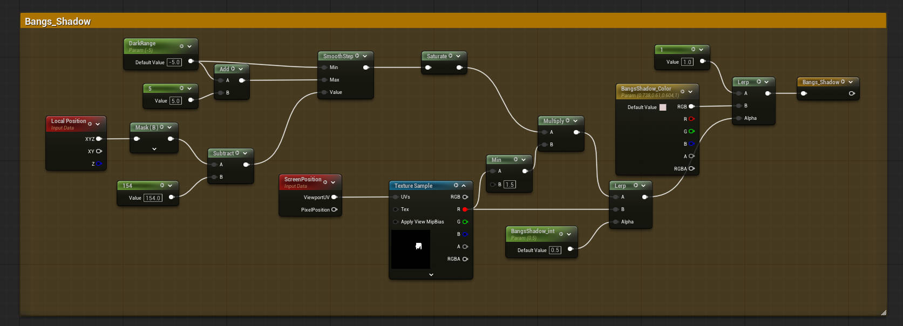
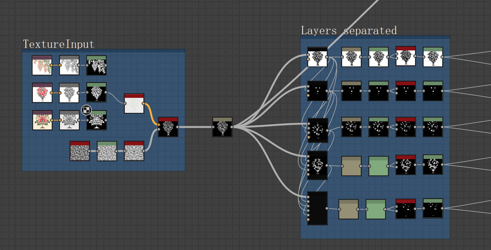
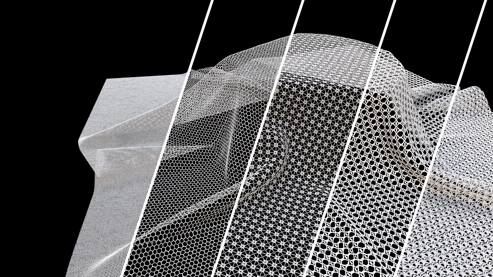
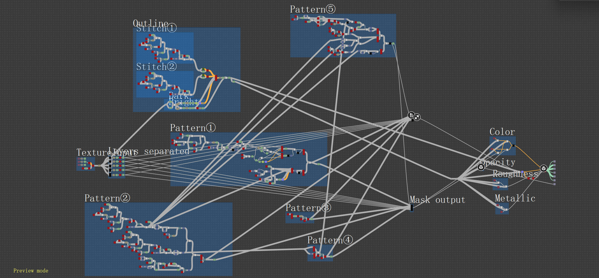
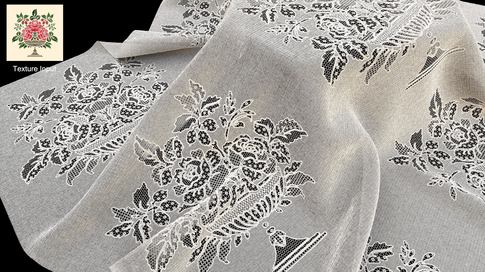
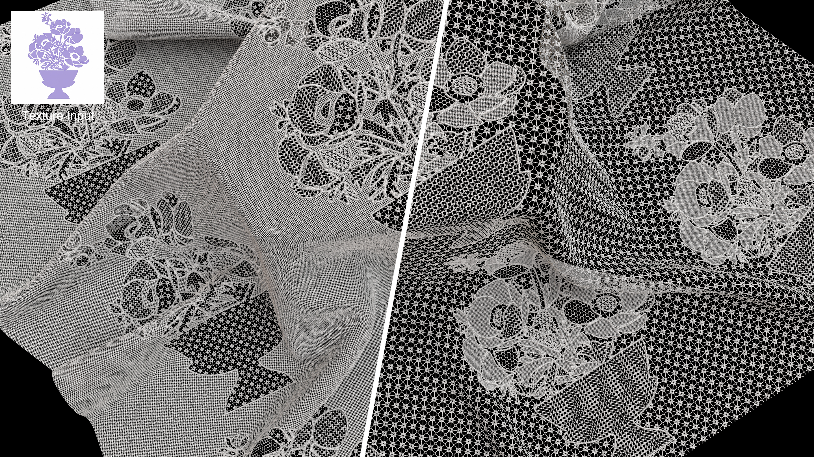
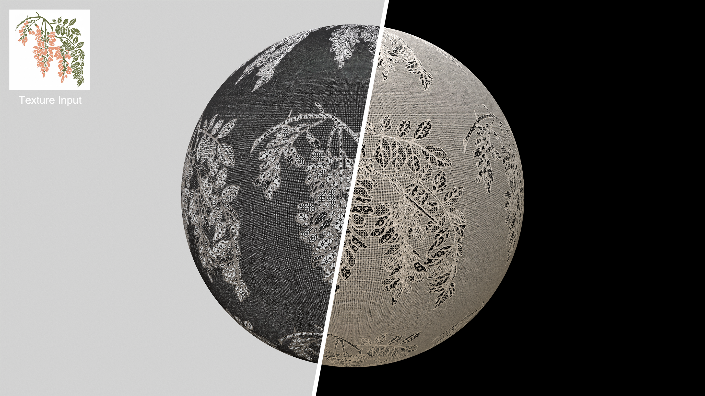
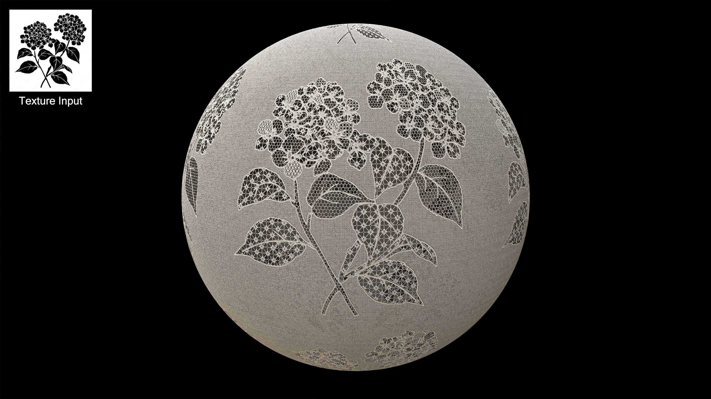
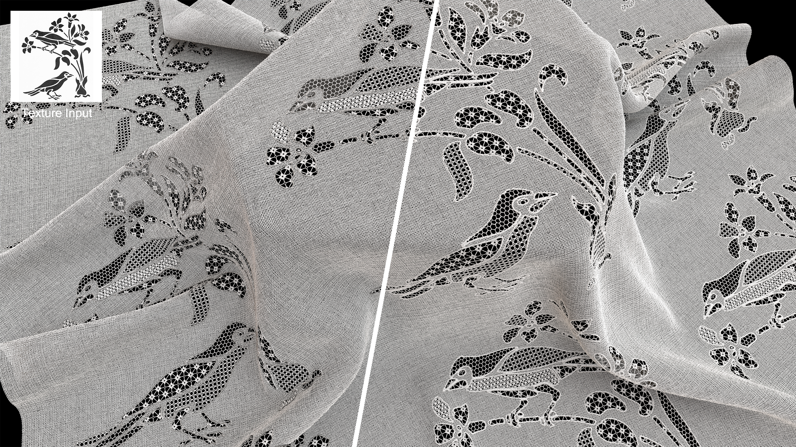
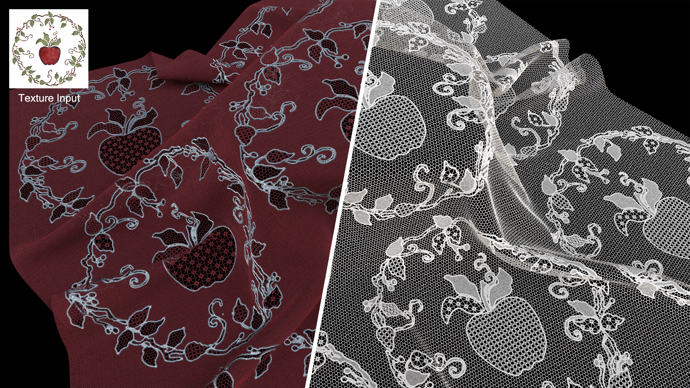

<video width="100%" height="auto" controls muted autoplay loop>
  <source src="/assets/img/20250910/CharactorPreview.mp4" type="video/mp4">

</video>

## 面部效果预览
<video width="100%" height="auto" controls muted autoplay loop>
  <source src="/assets/img/20250910/Face_preview.mp4" type="video/mp4">

</video>

## 1.刘海阴影

<video width="100%" height="auto" controls muted autoplay loop>
  <source src="/assets/img/20250910/BangShadow_demonstration.mp4" type="video/mp4">

</video>

刘海部分比较成熟的商业化方案涉及到改引擎渲染逻辑，需要把原本的逐物体半透明排序改成逐材质半透明排序，使刘海阴影的面片可以被单独赋予Stencil值。本篇为了在不改引擎的前提下达到同样效果，选择把刘海阴影模型分离出来挂载到角色蓝图中。

给刘海阴影模型赋予Stencil值后，在后处理材质中把Stencil遮罩画出，再烘焙到Render Target上，Render Target所挂载的Scene Capture2D要与当前窗口的摄像机同步。

{: width="972" height="589" }
_BangShadow Mask_

让阴影模型根据光方向与面部的夹角进行偏移，更符合物理规律。 

{: width="972" height="589" }
_BangShadow Offset_

在面部Shader中用ScreenPos采样RT；同时可以用LocalPos给刘海阴影做出一些由上到下的颜色深浅变化，避免死板。

{: width="972" height="589" }
_BangShadow Nodes_

## 2.面部的阴影与高光

基于灰度值进行分层（灰度值每增加0.2为一层，当然可以更多）。

{: width="972" height="589" }
_Layer Separating_

## 五种蕾丝纹理
{: width="972" height="589" }
_5 BasePatterns_

## 制作全流程

{: width="972" height="589" }
_The Entire Workflow_

材质使用演示： 



## 效果展示

{: width="972" height="589" }

{: width="972" height="589" }

{: width="972" height="589" }

{: width="972" height="589" }

{: width="972" height="589" }

{: width="972" height="589" }

更完整的作品展示：[Artwork in Artstation](https://www.artstation.com/artwork/rlNgAe)

