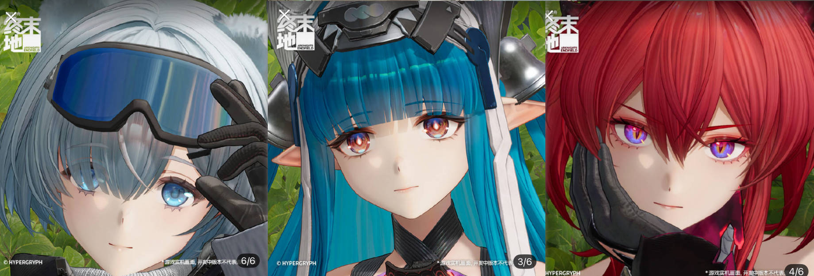
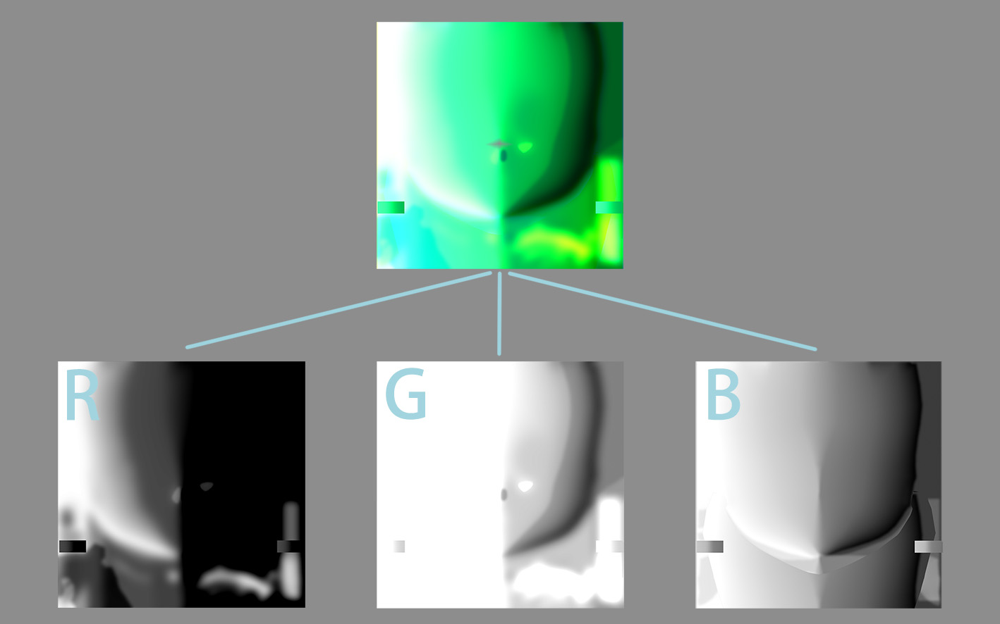
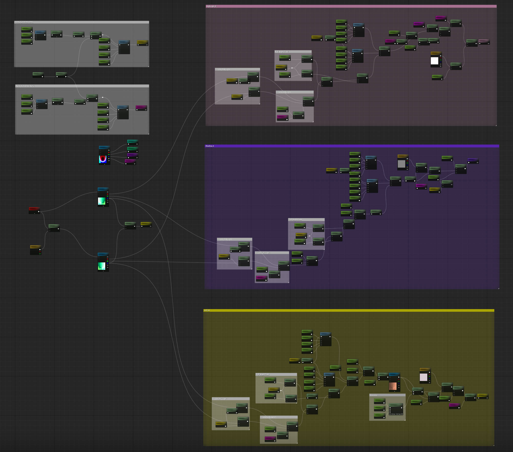
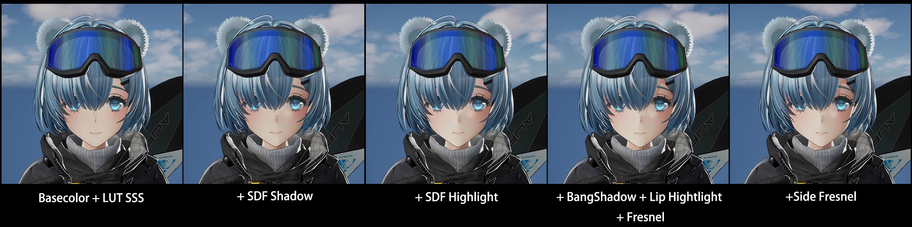
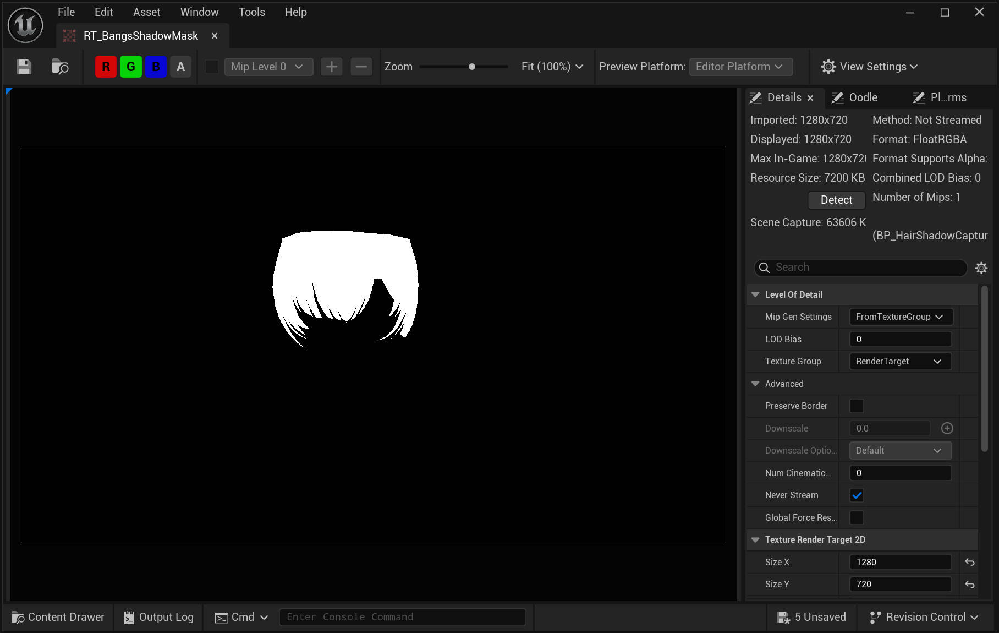
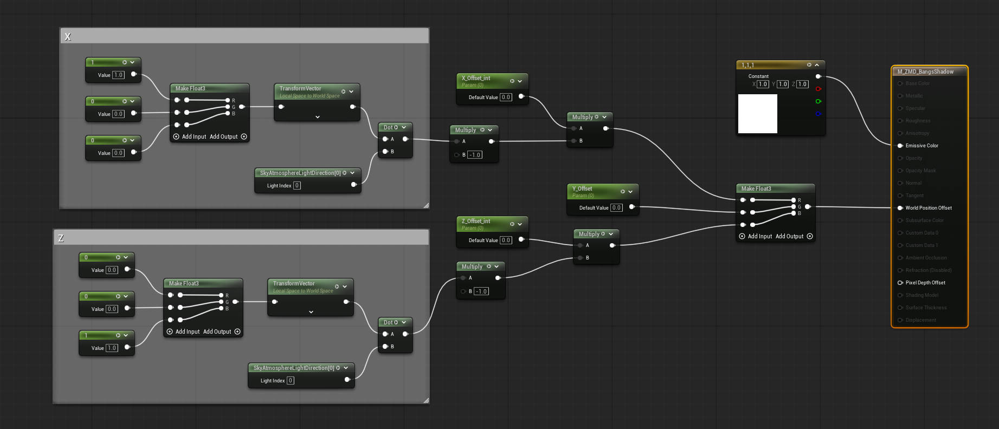
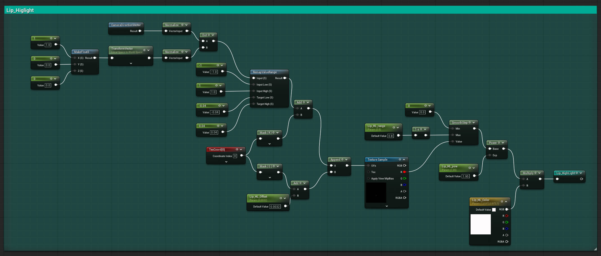

<video width="100%" height="auto" controls muted autoplay loop>
  <source src="/assets/img/20250910/CharactorPreview.mp4" type="video/mp4">

</video>

## 面部效果预览
<video width="100%" height="auto" controls muted autoplay loop>
  <source src="/assets/img/20250910/Face_preview.mp4" type="video/mp4">

</video>

## 1.面部的明暗

<video width="100%" height="auto" controls muted autoplay loop>
  <source src="/assets/img/20250910/FaceSDF_step.mp4" type="video/mp4">

</video>

官方渲染效果参考：
{: width="972" height="589" }
_Reference_
我将效果拆解为：Basecolor + 采样LUT图带有边缘染色的浅阴影 + 结构更细腻的SDF深阴影 + SDF高光 + 脸侧菲涅尔增加立体感。
浅阴影、深阴影、高光，分别使用SDF图的B、G、R通道：
{: width="972" height="589" }
_SDF Tex_

实现的大致思路：
①Basecolor部分先进行InverseTonemapping,Basecolor的A通道是角色鼻子阴影的遮罩，用来控制鼻子阴影颜色；
②用LDir与角色的X轴正方向点乘，step点乘结果以切换SDF图的采样方向，得到可随着光方向改变方向的阴影效果；
③再用LDir与角色的Y轴正方向点乘，用所得夹角大小smoothstep控制阴影与高光面积；
④用B通道最终算出的浅阴影的部分则还需用来采样LUT图，得到明暗交界线染色的浅阴影；
⑤为了让左右向阴影的切换更自然，我在光方向几乎完全正向或几乎完全背向时，在可调整的一定大小的夹角内，为面部制作了全白【无阴影】或全黑【全阴影】的明暗过度区间；
⑥叠加脸侧菲涅尔。

{: width="972" height="589" }
_LUTShadow+DarkShadow+Highlight nodes_

{: width="972" height="589" }
_FaceShader Steps_

## 2.刘海阴影

<video width="100%" height="auto" controls muted autoplay loop>
  <source src="/assets/img/20250910/BangShadow_demonstration.mp4" type="video/mp4">

</video>

刘海部分比较成熟的商业化方案涉及到改引擎渲染逻辑，需要把原本的逐物体半透明排序改成逐材质半透明排序，使刘海阴影的面片可以被单独赋予Stencil值。本篇为了在不改引擎的前提下达到同样效果，选择把刘海阴影模型分离出来挂载到角色蓝图中。

给刘海阴影模型赋予Stencil值后，在后处理材质中把Stencil遮罩画出并烘焙到Render Target上，RT所挂载的Scene Capture2D要与当前窗口的摄像机同步。

{: width="972" height="589" }
_BangShadow Mask RT_

让阴影模型顶点根据光方向与面部的夹角进行偏移，更符合物理规律。 

{: width="972" height="589" }
_BangShadow Offset_

在面部Shader中用ScreenPos采样RT；同时可以用LocalPos给刘海阴影做出一些由上到下的颜色深浅变化，避免死板。

{: width="972" height="589" }
_BangShadow Nodes_

## 3.嘴唇高光

嘴唇高光的实现思路：让嘴唇位置的高光Mask随着摄像机方向左右平移。具体方法就是用摄像机与角色X轴正方向的夹角大小控制Mask在X方向位移的距离。并用power控制高光大小。

<video width="100%" height="auto" controls muted autoplay loop>
  <source src="/assets/img/20250910/Lip_demonstration.mp4" type="video/mp4">

</video>

{: width="972" height="589" }
_LipHighlight Nodes_

