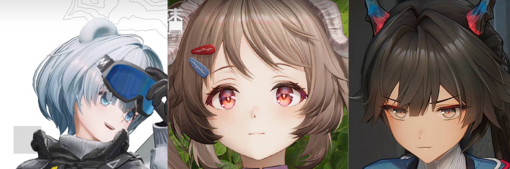
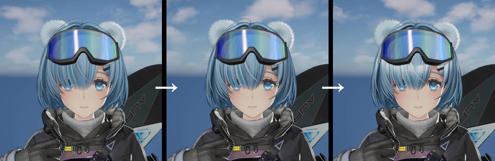
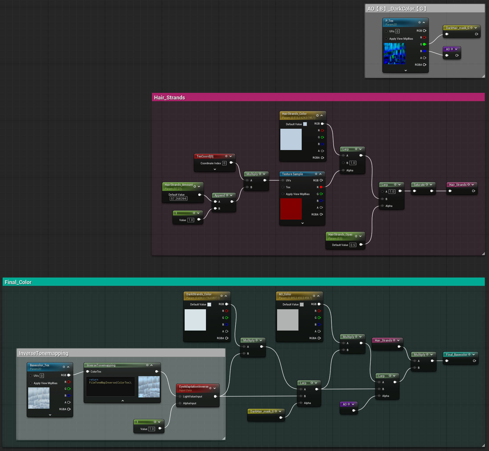
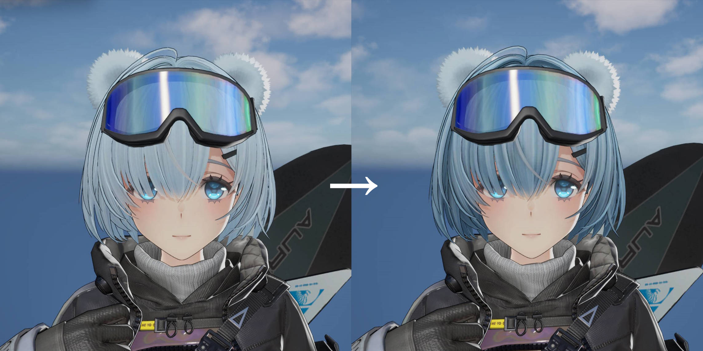
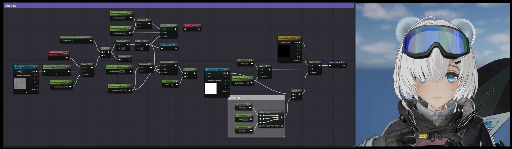
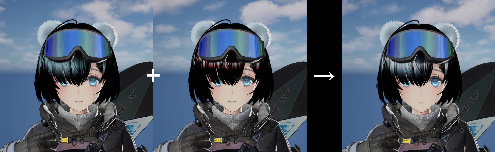
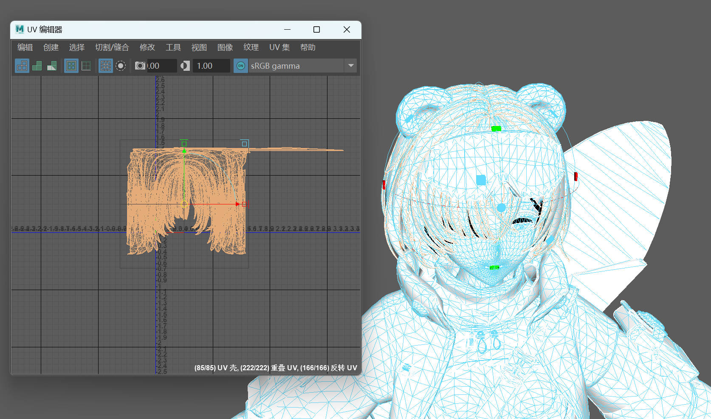
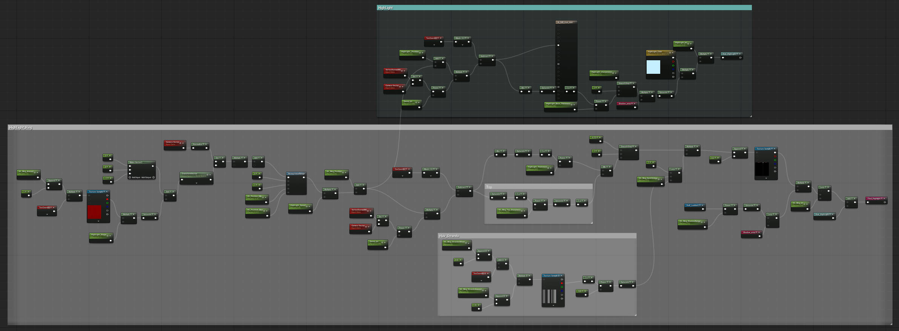
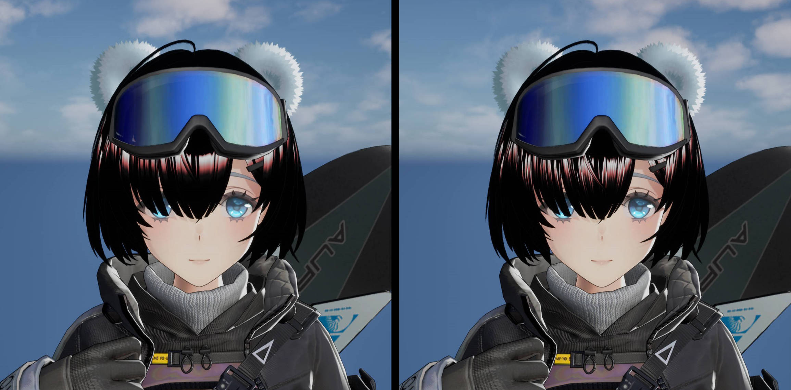
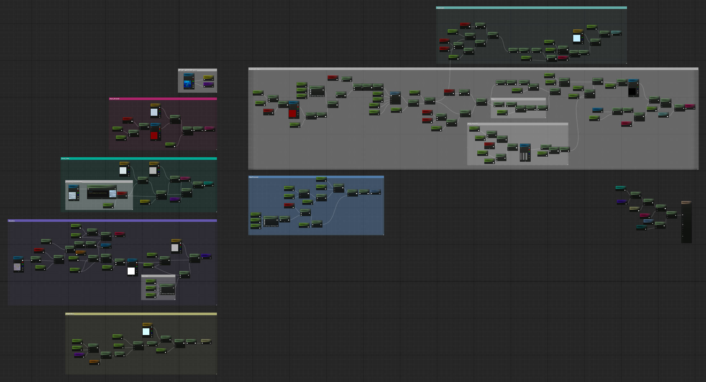

<video width="100%" height="auto" controls muted autoplay loop>
  <source src="/assets/img/20250910/CharactorPreview.mp4" type="video/mp4">

</video>

## 头发效果预览
<video width="100%" height="auto" controls muted autoplay loop>
  <source src="/assets/img/20250911/Hair_demonstration.mp4" type="video/mp4">

</video>

参数控制：
<video width="100%" height="auto" controls muted autoplay loop>
  <source src="/assets/img/20250911/Hair_parameters.mp4" type="video/mp4">

</video>

## 1.效果拆解

官方渲染效果参考：
{: width="972" height="589" }
_Reference_

我将效果拆解为：Basecolor + 发丝深浅变化 + 采样LUT图带有边缘染色的阴影 + AO + 环状高光光晕 + 环状风格化高光。
{: width="972" height="589" }
_HairShader steps_

## 2.Basecolor+发丝深浅变化+AO

这部分都是靠贴图提供的mask来制造颜色深浅变化，增加色彩丰富度。
{: width="972" height="589" }
_FinalBasecolor nodes_

增加颜色变化前后对比：
{: width="972" height="589" }
_Before/After Basecolor_

## 3.阴影部分

这个部分和常规的风格化阴影的做法一样，NdotL后采样LUT图得到边缘染色的阴影。
{: width="972" height="589" }
_Shadow nodes_

## 4.环状风格化高光

我把高光拆为两层：一层是高光光晕，一层是边缘染色的风格化高光。
{: width="972" height="589" }
_Highlight Layers_

为了让高光呈现圆润的环形，我的方法是在Maya里给角色的头发烘焙一套球形UV。
{: width="972" height="589" }
_Bake SphereUV_

为了让高光呈现圆润的环形，我的方法是在Maya里给角色的头发烘焙一套球形UV。
{: width="972" height="589" }
_Bake SphereUV_

环状高光的具体实现：将摄像机方向与角色Z轴负方向点乘，用点乘结果（即摄像机方向与Z轴夹角）控制球形UV在竖直方向上的滑动，再用NdotV与高光位置相乘，让高光在模型边缘卷曲，得到可控的环形效果。
{: width="972" height="589" }
_Highlight nodes_

曲度可控的环形高光：
<video width="100%" height="auto" controls muted autoplay loop>
  <source src="/assets/img/20250911/Warp.mp4" type="video/mp4">

</video>

从官方的渲染效果来看，环状高光的上边缘比较锋利，下边缘模糊且有明显的采样LUT图后的染色效果。我在高光上边缘做了一层遮罩，可以控制它的锋利程度。高光的间隔是乘了一张比较粗的发丝mask，高光边缘形状的扭曲是在计算Vdir dot (0,0,-1)时，用(0,0,-1)加上一层比较细的发丝mask来控制，mask的深浅影响扭曲强度。
高光边缘扭曲：
{: width="972" height="589" }
_Highlight edge warp_

以上所有部分叠加，就是最终效果：
{: width="972" height="589" }
_All nodes_

