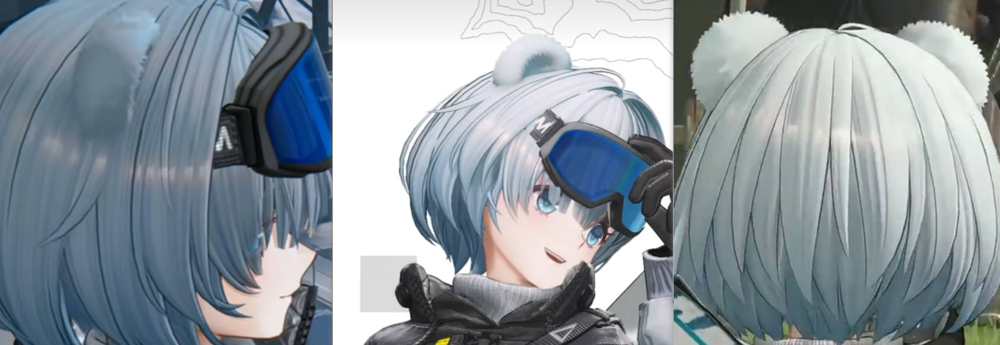
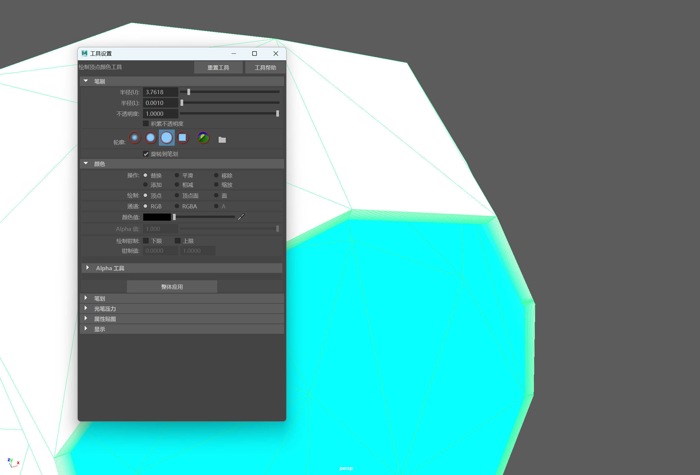
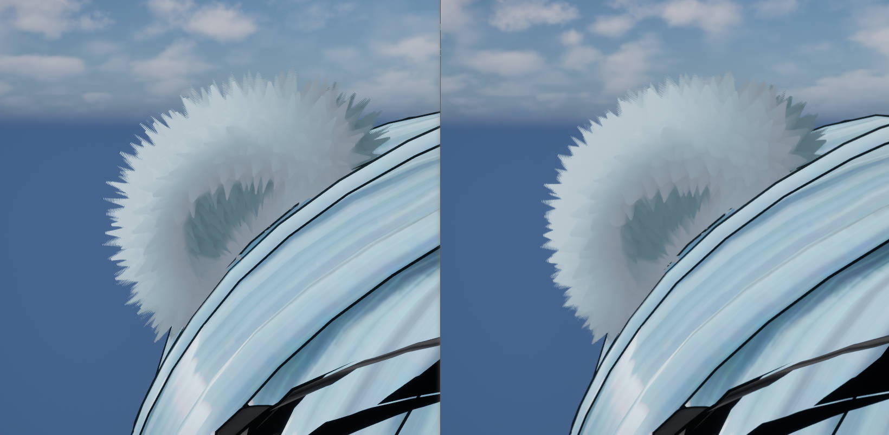
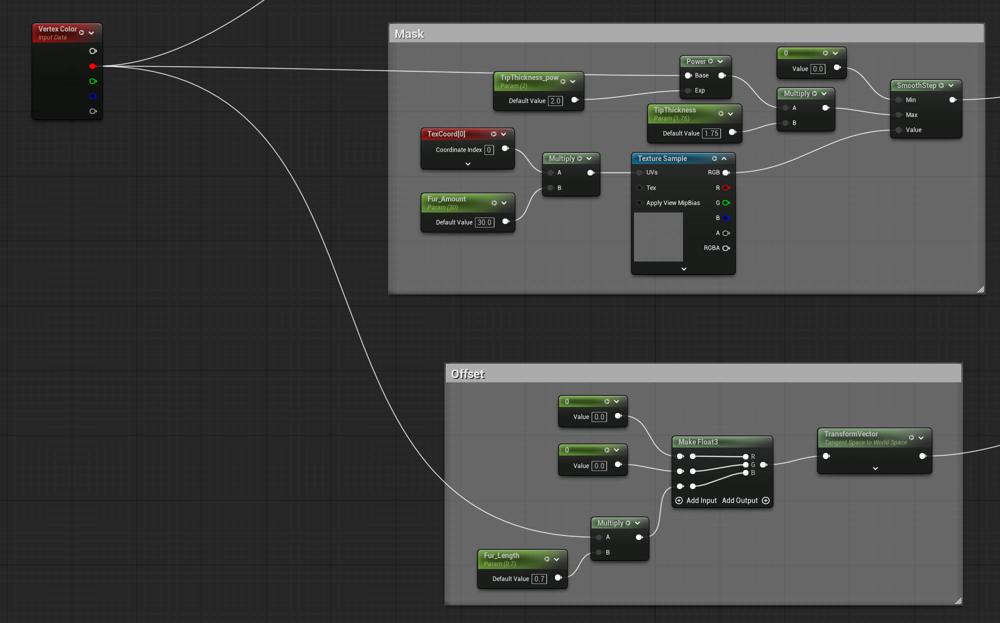
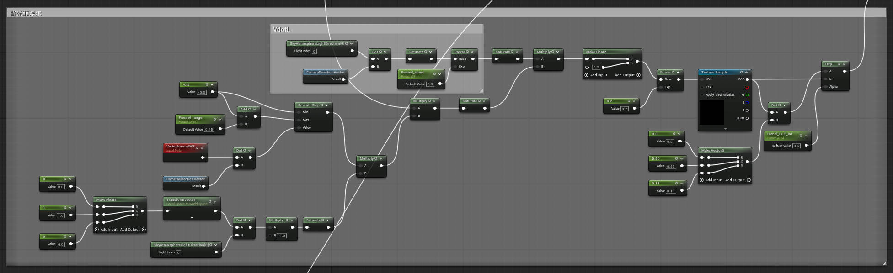

<video width="100%" height="auto" controls muted autoplay loop>
  <source src="/assets/img/20250910/CharactorPreview.mp4" type="video/mp4">

</video>

## 绒毛效果预览
<video width="100%" height="auto" controls muted autoplay loop>
  <source src="/assets/img/20250912/Fur_demonstration.mp4" type="video/mp4">

</video>

参数控制：
<video width="100%" height="auto" controls muted autoplay loop>
  <source src="/assets/img/20250912/Fur_parameters.mp4" type="video/mp4">

</video>

## 1.效果拆解

官方渲染效果参考：
{: width="972" height="589" }
_Reference_

我使用的方案就是常规的Shell-Fur方案，不过根据官方渲染的效果，阴影部分和头发一样采了LUT图做阴影边缘染色，并且为了让观感不那么闷，我在阴影内多叠了一层范围比较小的浅色阴影，还做了背光时的绒毛边缘光效果。

## 2.Shell-Fur

在Maya中把耳朵模型放大后发现，模型本身已经做成了20层相邻嵌套的壳，为了在shader中控制每层的毛发粗度与位移距离等，我在Maya里给每一层壳绘制了由0到0.95，逐层叠加0.05的顶点色。
{: width="972" height="589" }
_VertexColor_

接下来就是在shader里用顶点色值对noise图进行smoothstep，越往外的壳面积越小，就完成尖尖的绒毛效果了。但线性的数值变化会让绒毛看起来像等边三角形，很不可爱，所以我给顶点色多加了一步power，让绒毛边缘带了点弧度，观感会好很多，下图是power前后对比：
{: width="972" height="589" }
_Before-After power_

长度控制就是简单的让顶点朝外位移。

{: width="972" height="589" }
_Fur shape nodes_

## 3.背光边缘光

最后的这个部分就是用角色正面方向与光方向点乘，将结果取反，当光方向在角色背面的时候值为1，在正面时为0，作为遮罩乘上菲涅尔即可。我在这里也做了一层边缘染色，透光绒毛的边缘颜色饱和度更高，比较符合物理规律。
{: width="972" height="589" }
_Backlight nodes_

